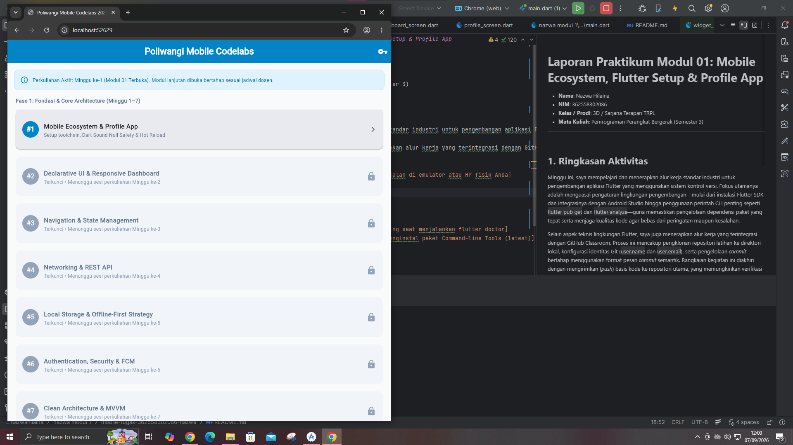
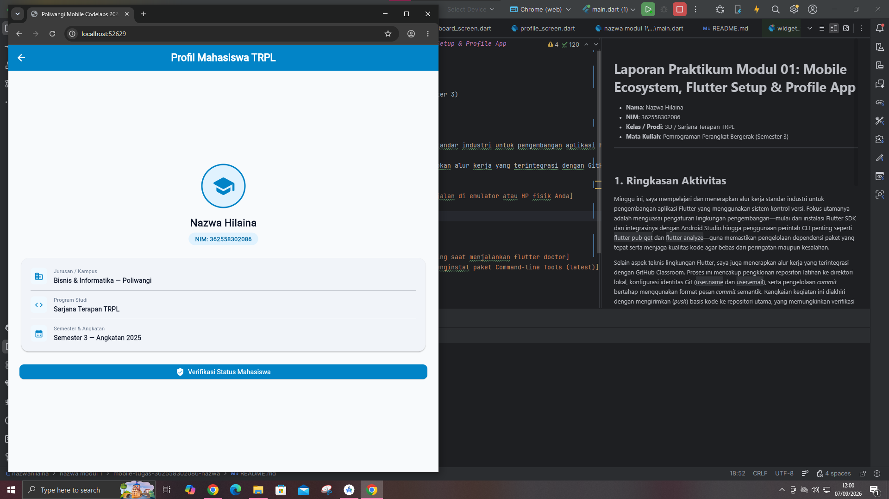

# Laporan Praktikum Modul 01: Mobile Ecosystem, Flutter Setup & Profile App

- **Nama**: Nazwa Hilaina
- **NIM**: 362558302086
- **Kelas / Prodi**: 3D / Sarjana Terapan TRPL
- **Mata Kuliah**: Pemrograman Perangkat Bergerak (Semester 3)

---

## 1. Ringkasan Aktivitas
Minggu ini, saya mempelajari dan menerapkan alur kerja standar industri untuk pengembangan aplikasi Flutter yang menggunakan sistem kontrol versi. Fokus utamanya adalah menguasai pengaturan lingkungan pengembangan—mulai dari instalasi Flutter SDK dan integrasinya dengan Android Studio hingga penggunaan perintah CLI penting seperti `flutter pub get` dan `flutter analyze`—guna memastikan pengelolaan dependensi paket yang tepat serta menjaga kualitas kode agar bebas dari peringatan maupun kesalahan.

Selain aspek teknis lingkungan Flutter, saya juga menerapkan alur kerja yang terintegrasi dengan GitHub Classroom. Proses ini mencakup pengklonan repositori latihan ke direktori lokal, konfigurasi identitas Git (`user.name` dan `user.email`), serta pengelolaan *commit* bertahap menggunakan format pesan *commit* semantik. Rangkaian kegiatan ini diakhiri dengan mengirimkan (*push*) basis kode ke repositori utama, yang memungkinkan verifikasi otomatis melalui sistem penilaian otomatis GitHub Actions.

## 2. Bukti Tangkapan Layar (Running App)
[Sertakan minimal 2 screenshot bukti aplikasi profil berjalan di emulator atau HP fisik Anda]

## 3. Kendala yang Dihadapi & Solusinya
- **Kendala**: Mengalami kegagalan saat melakukan git commit dengan pesan error Author identity unknown, serta kendala konfigurasi identitas pengguna Git yang belum terdaftar di sistem lokal.
- **Solusi**: Mengonfigurasi identitas Git terlebih dahulu di terminal menggunakan perintah git config --global user.name dan git config --global user.email, kemudian melakukan commit ulang dan push perubahan ke repositori GitHub.
## 4. Jawaban Pertanyaan Refleksi
1. **Pilihan Native vs Flutter**: Flutter lebih unggul untuk pengembangan lintas platform (cross-platform) karena menggunakan satu basis kode (single codebase) untuk Android dan iOS sekaligus, sehingga menghemat waktu dan biaya. Native (Kotlin/Swift) dipilih jika aplikasi membutuhkan akses fitur hardware secara mendalam atau performa grafis maksimal.
2. **Prinsip UI = f(state)**: Tampilan antarmuka (UI) merupakan hasil langsung dari data atau kondisi aplikasi (state) pada waktu tertentu. Ketika state berubah, Flutter secara otomatis memperbarui dan merekayasa ulang tampilan sesuai dengan data terbaru tersebut.
3. **Pentingnya Conventional Commits**: Memberikan standar format pesan commit yang konsisten dan terstruktur (seperti feat:, fix:), sehingga riwayat perubahan kode mudah dibaca oleh tim, mempermudah pelacakan bug, serta memungkinkan otomatisasi pembuatan changelog.